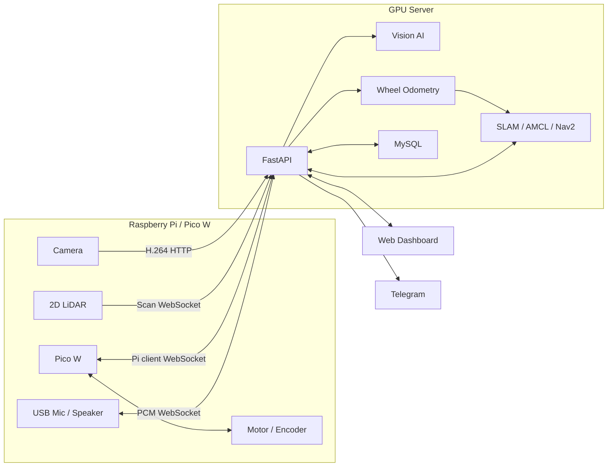

# 다봄 (DABOM) — Autonomous Patrol Bot

> 자율주행·AI 위험 행동 분석·실시간 웹 관제를 통합한 지능형 방범 RC카

다봄은 교내 CCTV의 감시 사각지대를 보완하고 학생 안전을 강화하기 위해 제작한 졸업작품입니다. 이동 로봇이 교내를 순찰하며 주변 환경과 사람의 행동을 관측하고, 관리자가 웹 대시보드에서 현장 상황을 확인하고 원격으로 대응할 수 있도록 구성했습니다.

**프로젝트 상태:** 2026년 졸업작품 개발 종료. 최종 통합 소프트웨어와 설계·제출 자료를 보존하는 저장소입니다.

## 1. 주요 기능

| 기능 | 구현 내용 |
| --- | --- |
| Mapping | 2D LiDAR 및 SLAM Toolbox 기반 지도 생성·저장 |
| Localization | AMCL 기반 위치 추정, 자동 초기 위치 추정 및 수동 초기 위치 지정 |
| Navigation | ROS 2 Nav2 기반 경로 계획·추종 및 장애물 대응 |
| Recorded Loop | 수동 명령 재생 및 Nav2 기반 반복 순찰 |
| Vision AI | RTMO-M, BoT-SORT, X3D-M 기반 자세 추정·추적·위험 행동 분석 |
| Web Dashboard | 실시간 영상, 3D 지도 및 센서 시각화, 수동/자동 주행, 이벤트·조치 기록 |
| Audio Intercom | USB 마이크·스피커 기반 웹 ↔ 로봇 양방향 음성 통신 |
| Warning / Report | LED, Pico W 경고음, 한국어 TTS, Telegram 신고 |
| Safety | 제어권 관리, E-STOP, 통신 watchdog 및 모터 PWM 제한 |

### 1.1 자율주행 및 반복 순찰

- **Mapping:** SLAM Toolbox로 2D Occupancy Grid를 생성하고 저장합니다.
- **Driving:** 저장 지도와 AMCL 위치 추정을 바탕으로 Nav2를 실행합니다.
  - Global Planner: 자체 C++ 플러그인 `TimeScoredLatticePlanner`
  - Controller: 자체 C++ 플러그인 `SegmentedRPPController` (일반 주행은 Rotation Shim과 결합)
  - 장애물 판단: Nav2 Costmap 및 차체 충돌 검사
- **LOOP MANUAL:** 기록된 모터 명령의 시간과 순서를 유지하여 반복 주행하며, 장애물 감지 시 정지 후 해소를 기다립니다.
- **LOOP AUTO:** 기록된 목표점을 Nav2로 추종합니다. WAIT는 장애물 해소를 기다리고, REPLAN은 차단된 경로의 재계획을 요청합니다.

Mapping과 Driving은 동시에 실행하지 않습니다. 실제 주행 전 위치 추정 및 안전 상태 확인이 필요합니다.

### 1.2 Vision AI 및 위험 상황 대응

```text
Camera → H.264 → GPU Server
                     ├─ RTMO-M → BoT-SORT → 자세/추적 시각화
                     └─ X3D-M → 장면 행동 분류
                                       ↓
                           위험 판단 / 웹 관제
                                       ↓
                            LED · Beep · TTS · Telegram
```

| 모델 | 역할 |
| --- | --- |
| RTMO-M | 실시간 다중 인원 2D Pose Estimation |
| BoT-SORT | 프레임 간 사람 추적 및 ID 유지 |
| X3D-M | 연속 RGB 프레임 기반 장면 행동 인식 |

최종 AI runtime은 `PIPELINE=8`을 사용합니다. 자세 추정·추적 경로와 장면 행동 인식 경로는 분리되어 있으며, X3D-M은 RGB 영상을 입력받습니다.

관리자는 웹에서 현장 음성을 청취하거나 로봇의 USB 스피커로 말을 전달할 수 있습니다. 수동 경고·신고 기능은 LED, Beep, 한국어 TTS 및 Telegram 전송과 연동됩니다. AI 자동 경고는 별도의 활성화 및 dry-run 검증을 전제로 합니다.

## 2. 시스템 아키텍처

| 구성 요소 | 역할 |
| --- | --- |
| Raspberry Pi | 카메라·LiDAR·엔코더 데이터 수집, Pico W UART 통신, USB 음성 입출력 |
| Pico W | MDD10A 모터 제어, 엔코더 수집, LED 및 경고음 제어 |
| 2D LiDAR | RPLIDAR A1M8 / 환경 인식 |
| Camera | 최종 전시 통합: Camera Module 3 (IMX708), 기존 OV5647 구성 이력 |
| GPU Server | FastAPI, Vision AI, ROS 2 Mapping/Localization/Nav2, Wheel Odometry, DB |
| Web Client | 브라우저 기반 관제 및 원격 제어 |

- 저장소의 Raspberry Pi 기본 대상: Raspberry Pi 3 Model B (1GB), Ubuntu Server 22.04 arm64
- GPU 환경: Ubuntu 22.04 / WSL2, ROS 2 Humble, CUDA 지원 NVIDIA GPU 및 Python
- 서버 및 데이터 관리: FastAPI, MySQL, HTTP, WebSocket
- 장치 간 연결: Tailscale 등 신뢰 가능한 네트워크



Pi와 GPU의 ROS 2 통신은 각 호스트 내부에서 이루어지며, 장치 간 센서 전달에는 HTTP/WebSocket을 사용합니다. GPU ROS bridge가 `/scan`, `/wheel_ticks`를 발행하고 Wheel Odometry가 `/odom` 및 `odom → base_link` TF를 생성합니다.

## 3. 설치 및 환경 설정

### 공통 준비

```bash
git clone https://github.com/jcy9066/dabom_capstone.git
cd dabom_capstone
cp .env.example .env
```

최종 통합 소프트웨어가 포함된 브랜치에서 GPU와 Pi의 `.env`를 각각 설정합니다.

- 서버 접속 설정: `SERVER_HOST`, `SERVER_PORT`, `SERVER_BASE_URL`
- 로봇 인증: `ROBOT_ID`, `ROBOT_CONTROL_TOKEN`
- DB, 인증, Telegram 및 ROS 2 설정
- LiDAR 장착 TF, UART/serial device, 엔코더 및 모터 보정값
- GPU 모델 설정: `PIPELINE=8`, `DEVICE`, `CUDA_DEVICE_INDEX`

실제 운영 주소, 토큰, 비밀번호 및 `.env`는 저장소에 공개하지 않습니다. 초기 검증은 `MOTOR_OUTPUT_ENABLED=false`로 시작하고, Nav2 dry-run, E-STOP 및 watchdog 검증 후에만 실제 모터 출력을 활성화합니다.

### GPU Server

ROS 2 Humble, Nav2, SLAM Toolbox, Python 및 CUDA 환경을 준비합니다.

```bash
python3 -m pip install -r requirements.txt

source /opt/ros/humble/setup.bash
cd navigation/ros
colcon build --symlink-install --packages-select patrol_navigation_controller patrol_navigation
source install/setup.bash
ros2 pkg prefix patrol_navigation_controller
cd ../..
```

GPU launcher는 추론 또는 시각화가 활성화된 경우 Pipeline 8의 의존성과 모델 자산을 확인합니다. 최초 모델 다운로드 및 CUDA 초기화에는 추가 시간이 필요할 수 있습니다.

### Raspberry Pi

Ubuntu Server 22.04 arm64, ROS 2 Humble, `rpicam-vid`, RPLIDAR ROS driver 및 UART/카메라 접근 권한을 준비합니다. 음성 기능에는 ALSA(`arecord`, `aplay`, `amixer`)와 USB 오디오 장치가 필요하고, 전시 launcher에는 `tmux`와 `flock`이 필요합니다.

```bash
python3 -m pip install -r raspberry/requirements.txt

source /opt/ros/humble/setup.bash
cd navigation/ros
colcon build --symlink-install --packages-select patrol_navigation
cd ../..
```

Pico W UART 연결:

```text
Pi GPIO14 / TXD (physical pin 8)  -> Pico W RX
Pi GPIO15 / RXD (physical pin 10) <- Pico W TX
Pi GND                            <-> Pico W GND

MOTOR_SERIAL_PORT=/dev/serial0
MOTOR_SERIAL_BAUDRATE=115200
```

Pico와 LiDAR는 동일한 serial device를 사용할 수 없습니다.

## 4. 실행 방법

### 4.1 GPU Server

```bash
cd ~/dabom_capstone
bash start_gpu_server.sh
```

FastAPI 및 Wheel Odometry를 시작합니다. Mapping과 Driving은 자동으로 시작하지 않고 대시보드에서 선택할 때 실행합니다.

### 4.2 Raspberry Pi

기본 센서·영상·로봇 제어 stack:

```bash
cd ~/dabom_capstone
bash start_pi_stack.sh
```

Pico UART PING/STOP, 카메라 탐지, LiDAR scan 수신을 확인한 후 Robot Client, LiDAR Sender 및 H.264 영상 전송을 시작합니다.

음성 관제를 포함한 **최종 전시 실행**은 다음 launcher를 사용합니다.

```bash
bash start_dabom_pi_demo_v2.sh
```

전시 launcher는 Pi의 설치 경로를 ROOT로 지정하고 기본 Pi stack과 오디오 클라이언트를 tmux로 실행합니다. 다른 설치 경로에서는 ROOT 설정을 확인해야 합니다. 이미 실행 중인 오디오 클라이언트는 중복 실행하지 않습니다. 기본 stack은 재시작할 수 있으므로 반드시 모터가 정지한 상태에서 실행합니다.

오디오 장치 확인 또는 별도 실행:

```bash
python3 raspberry/audio_intercom_client.py --check

# 별도 터미널 또는 tmux에서 실행 (이미 실행 중이면 중복 실행 금지)
set -a
source .env
set +a
python3 raspberry/audio_intercom_client.py
```

### 4.3 Web Dashboard

- 서버 설정에 맞는 주소와 포트로 접속하고 로그인 후 `/main`에서 관제합니다.
- 별도 오디오 시험 페이지: `/audio/intercom-test`
- 브라우저 마이크는 HTTPS 또는 localhost 보안 컨텍스트에서 사용할 수 있습니다.
- 메인 대시보드와 오디오 시험 페이지는 동일 오디오 세션을 공유하므로 동시에 연결하지 않습니다.
- 오디오 형식: 16 kHz / Mono / PCM signed 16-bit little endian / 20 ms 프레임. 서버에 녹음 파일을 저장하지 않습니다.

### 4.4 실행 확인

GPU 서버에서 실제 포트에 맞게 로컬 상태를 확인합니다. 다음은 전시 기본 포트 21063의 예입니다.

```bash
curl http://localhost:21063/get_status
curl http://localhost:21063/api/stream_status
curl http://localhost:21063/api/lidar/bridge
curl http://localhost:21063/api/encoder/bridge
curl http://localhost:21063/api/navigation/status
curl http://localhost:21063/api/audio/status
```

인증이 필요한 API는 로그인 세션을 사용하는 브라우저에서 확인합니다. 오디오 상태에서는 dashboard와 robot 연결 여부를 각각 확인합니다.

```bash
source /opt/ros/humble/setup.bash
source ~/dabom_capstone/navigation/ros/install/setup.bash
ros2 topic hz /scan
ros2 topic hz /wheel_ticks
ros2 topic hz /odom
ros2 run tf2_ros tf2_echo odom base_link
```

| Launcher 상태 | 의미 |
| --- | --- |
| READY | 로컬 필수 구성 준비 완료 |
| WAITING | 상대 장치 연결 대기 |
| CONNECTED | 상대 장치 연결 |
| ERROR | 필수 구성 시작 실패 |
| WARN | 실행 중 경고 또는 재연결 |

GPU/Pi 실행 순서는 상관없으며, 상대 장치가 꺼져 있다는 이유만으로 로컬 stack을 실패 처리하지 않습니다.

## 5. 저장소 구조

```text
dabom_capstone/
├── start_gpu_server.sh
├── start_pi_stack.sh
├── start_dabom_pi_demo_v2.sh
├── server/                     # FastAPI, ROS bridge, Navigation, Loop, Audio
├── raspberry/                  # Pi client, 장치 제어, Pico W SDK
├── navigation/ros/             # ROS 2 패키지, Nav2 C++ 플러그인
├── perception/                 # AI 모델 및 추론 파이프라인
├── frontend/                   # 웹 대시보드 및 3D Viewer
├── data/                       # 지도 및 순찰 경로 관련 데이터
├── scripts/                    # 검증 및 진단 도구
├── tests/                      # 소프트웨어 테스트
├── docs/                       # 기술 문서 및 개발 기록
├── pico_motor_controller.uf2   # 보존된 Pico W 펌웨어
└── .env.example                # 환경 설정 템플릿
```

## 6. 프로젝트 문서

| 분류 | 자료 |
| --- | --- |
| 최종 제출 | [최종 보고서](./다봄_최종보고서.pdf), [최종 발표자료](./다봄_최종발표.pptx) |
| 전시 자료 | [포스터](./포스터.pptx), [팜플렛](./팜플렛.pptx) |
| 중간 제출 | [중간 보고서](./다봄_중간보고서.pdf), [중간 발표자료](./다봄_중간발표.pptx) |
| 프로젝트 계획 | [프로젝트 개요](./프로젝트%20개요.pdf), [프로젝트 진행 상황도](./프로젝트%20진행%20상황도.pdf), [제작계획서](./졸업작품%20제작계획서.hwp), [요구사항 정의서](./Dabom_요구사항_정의서.xlsx) |
| 설계 자료 | [Activity Diagram](./Activity_Diagram.png), [Activity Diagram 2](./Activity_Diagram_2.png), [DFD](./DFD.png), [ERD](./ERD.png) |
| 하드웨어 | [상단 섀시](./RC카%20상단%20섀시.3mf), [하단 섀시](./RC카%20하단%20섀시.3mf) |
| 구매 내역 | [1차](./부품구매내역서_1차_40만원.xlsx), [2차](./부품구매내역서_2차_20만원.xlsx), [3-1차](./부품구매내역서_3-1차_10만원.xlsx), [3-2차](./부품구매내역서_3-2차_10만원.xlsx), [3-3차](./부품구매내역서_3-3차_5만원.xlsx), [4차](./부품구매내역서_4차_30만원.xlsx) |
| 기술 기록 | [개발 문서](./docs/), [음성 관제 MVP](./docs/audio_intercom_mvp.md), [음성 관제 Phase 2](./docs/audio_intercom_phase2.md), [자동 경고](./docs/automatic_warning.md) |

기술 기록은 각 개발 단계 당시의 자료입니다. 과거 패치 적용 절차 및 환경 설정은 최종 통합 코드와 다를 수 있습니다.

## 7. 최종 통합 검증 및 한계

최종 통합 [PR #98](https://github.com/jcy9066/dabom_capstone/pull/98)의 기록 기준입니다.

| 검증 항목 | 상태 |
| --- | --- |
| Camera Module 3 영상 전송 | 실기기 확인 기록 |
| 웹 ↔ 로봇 음성 송수신 | 실기기 확인 기록 |
| 수동 경고 및 Telegram 신고·TTS | 실기기 확인 기록 |
| LiDAR 및 로봇 상태 통신 | 실기기 확인 기록 |
| GPU/Pi 통합 실행 | 실기기 확인 기록 |
| 전체 회귀 테스트 및 모션 안전 테스트 정리 | 최종 검증 미완료 |
| Pi 재부팅 후 전체 환경 복구 | 추가 검증 필요 |
| 최종 자율주행 및 Recorded Loop 현장 검증 | PR 기록상 추가 검증 필요 |

- DNS/NTP 및 일부 지도 경로는 장비별 설정이므로 저장소 복제만으로 전시 환경이 자동 재현되지는 않습니다.
- 별도 `fix/motion-stop-ack-race-20261111` 브랜치의 독립 STOP/MOVE ACK 수정 커밋은 PR #98에 직접 포함되지 않았습니다.
- AI 위험 판단에는 오탐·미탐 가능성이 있으며, 완전한 무인 운영 및 안전을 보장하는 인증 제품이 아닙니다.
- 소프트웨어 검증과 실제 하드웨어 검증을 구분합니다.

변경 영역별 개발 검증은 `.agents/skills/`의 `validate-server`, `validate-dashboard`, `validate-navigation`, `validate-raspberry`, `review-change`를 참고합니다.

## 8. Pi/GPU 시간 동기화 및 LiDAR TF

The GPU server (including WSL2) and Raspberry Pi are independent hosts.
Copying `.env` does **not** change OS time. When
`LIDAR_USE_SOURCE_TIMESTAMP=true`, raw Pi scan stamps previously appeared
0.1-0.4 seconds in the GPU's future, causing TF future-stamp warnings.

With this revision the Pi's LiDAR sender takes authenticated, short-RTT
samples from `/api/time/sync` every 15 seconds, estimates the GPU-minus-Pi
offset, and translates LiDAR stamps to the GPU's clock domain. No root
permissions, OS clock changes, or new `.env` secrets are required. During
startup, loss of synchronization or high network latency, the GPU stamps
incoming scans with its own receipt time. This **fallback is approximate**:
it may introduce latency error, so persistent bad sync still needs repair.

On the **Pi**, with the GPU server already running:

```bash
cd ~/dabom_capstone
python3 scripts/check_gpu_pi_clock.py
timedatectl status
```

On the **GPU server**:

```bash
timedatectl status
date -u '+%Y-%m-%dT%H:%M:%S.%NZ'
```

For a Pi using systemd-timesyncd, enable its normal automatic NTP sync
(when running a different time client such as chrony, use that instead):

```bash
sudo timedatectl set-ntp true
timedatectl timesync-status
```

For a GPU host running WSL2, synchronize **Windows** time first; WSL2
normally receives its time from the Windows/Hyper-V host. Run
`w32tm /query /status` from Windows PowerShell. Reinitialize WSL using
`wsl --shutdown` **only with all robot/GPU processes safely stopped**;
this forcibly terminates WSL sessions. Do not automatically set host time
while motors or navigation are running.

Review only non-secret settings on each machine; the user-managed local
`.env` is not stored in GitHub:

```bash
grep -nE '^(LIDAR_USE_SOURCE_TIMESTAMP|PIPELINE|STATUS_REQUEST_TIMEOUT_SEC)=' .env
```

`STATUS_REQUEST_TIMEOUT_SEC` governs Pi HTTP `/status` telemetry and
is unrelated to LiDAR clock skew. Repeated HTTP timeouts or WebSocket
`InvalidMessage` still need an independent network/server-load check.

GPU-first deployment: when the Pi is still running an older branch without
`clock_sync_valid` in LiDAR packets, the updated GPU bridge uses receipt
timestamps rather than trusting unsynchronized Pi timestamps. This prevents
future-stamp warnings while preserving LiDAR delivery, but it cannot provide
accurate sensor exposure times. After updating both ends, the authenticated
clock probe supplies corrected source timestamps.

## 9. 모터 PWM 30% 안전 제한 (PR #90)

All **motor-drive** PWM outputs are limited to 30% duty magnitude on both
hosts: manual `MOVE` (forward, reverse, turns, spin), Nav2 autonomous
`DRIVE`, and the Pico's physical PWM channels. Left/right commands preserve
their steering ratio when scaled. STOP, emergency STOP, direction-reversal
interlocks, watchdogs and buzzer volume are unchanged.

- Pi `raspberry/controllers/motor_controller.py`: always caps signed PWM
  to ±0.300 before UART, including the output **after** jerk limiting.
- Pico `raspberry/pico_w_sdk/main.c`: `MOTOR_MAX_PWM=0.30f`; directly
  received commands are capped in the command handlers and again in
  `motor_request_signed_speed()` / `motor_write_pwm()`.
- GPU Nav2 `nav2_command_bridge.py` diagnostic estimates cap at 0.300.
  `MIN_AUTO_DRIVE_PWM` can never override the physical ceiling.

**Important:** Flashing the **updated firmware** is required for the Pico-side
change. Pulling the GitHub branch only updates source files, not the
firmware already running on the MCU. With wheel power safely disconnected,
compile the firmware using the installed Pico SDK:

```bash
cmake -S raspberry/pico_w_sdk -B raspberry/pico_w_sdk/build
cmake --build raspberry/pico_w_sdk/build -j2
```

Deploy `raspberry/pico_w_sdk/build/pico_motor_controller.uf2` to the
Pico W via BOOTSEL. Check Pico startup/UART STOP behavior before
reconnecting motor power. The Pi runtime must also be restarted to load
the new Python code; GPU runtime/rebuilt ROS overlay is required for new
Nav2 diagnostic output.

**This is a duty-cycle limit, not current limiting.** A stalled motor,
mechanical obstruction, high startup current, undersized wiring or a
damaged MDD10A can still exceed its thermal/electrical capacity at 30%.
Check wheel freedom, wiring and driver temperature/current before
resuming physical navigation. `MAX_WHEEL_MPS=0.212` was only a theoretical
100%-PWM wheel-speed ceiling; remeasure actual wheel speed at <=30% and
recalibrate Nav2 and both hosts before relying on traversal-time or
blocked-progress thresholds. Low PWM may fail to overcome stiction and
trigger `BLOCKED_TIMEOUT`; never automatically raise PWM to compensate.
