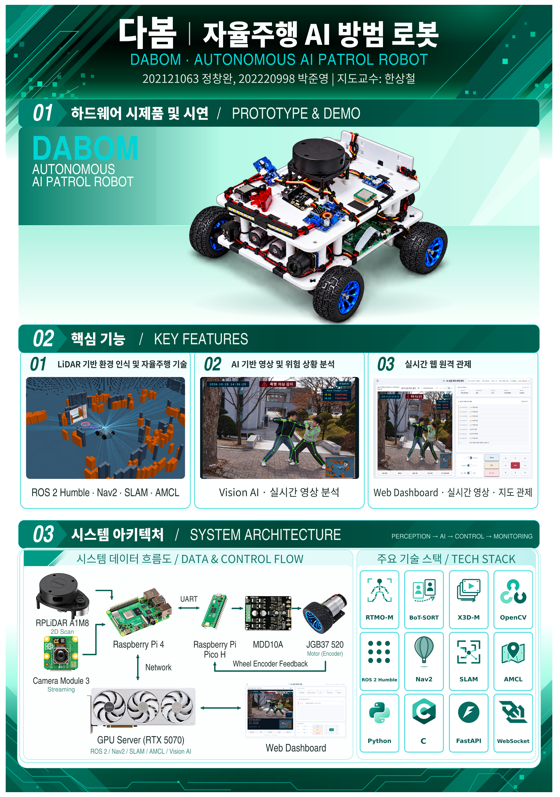
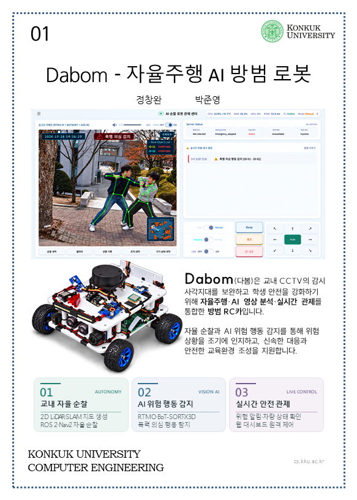
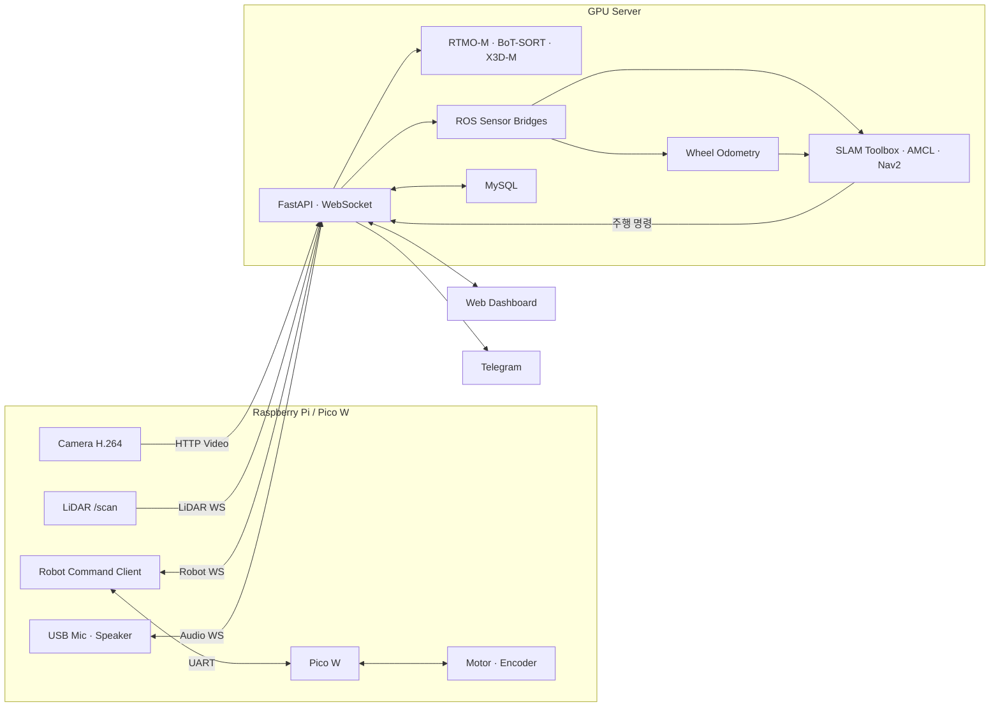
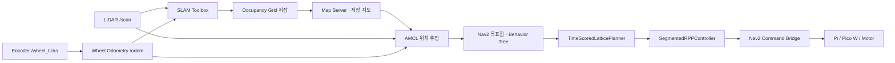
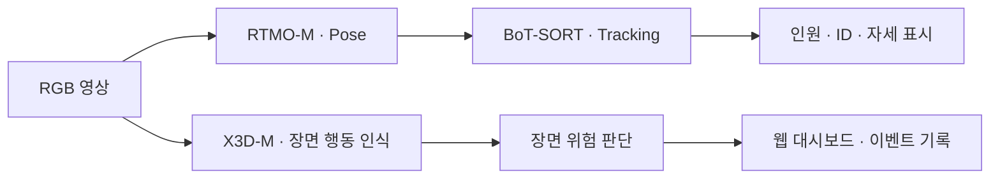
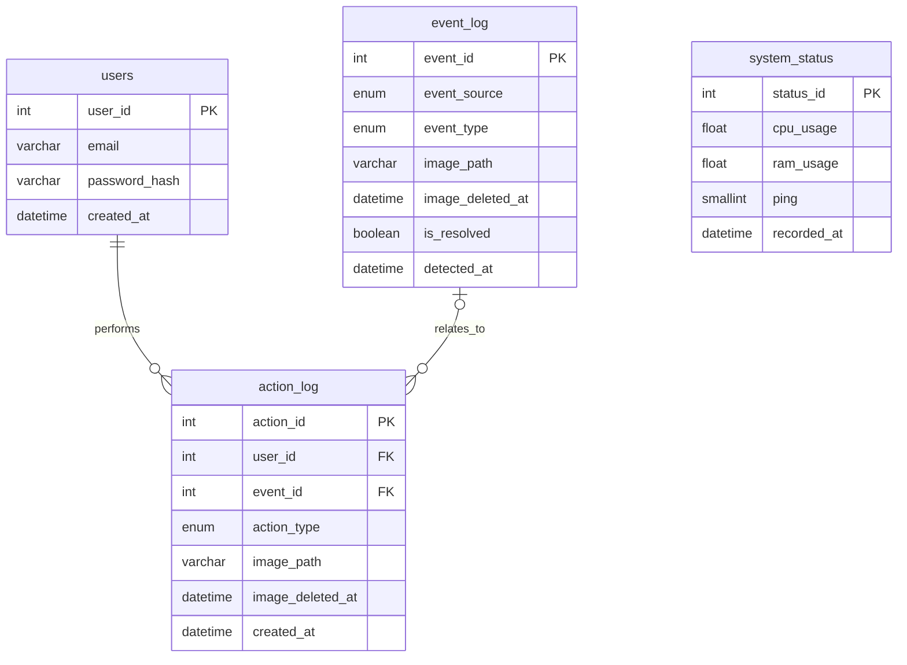

# 다봄 (DABOM) — Autonomous Patrol Bot

**자율주행 · AI 위험 행동 분석 · 실시간 웹 관제를 통합한 지능형 방범 RC카**

다봄(DABOM)은 교내 CCTV의 감시 사각지대를 보완하기 위해 제작한 자율순찰 로봇입니다. 2D LiDAR 기반 자율주행과 카메라 기반 행동 분석을 결합하여 주변 환경을 관측하고, 관리자가 웹 대시보드에서 주행·경고·신고 및 양방향 음성 통신을 제어할 수 있도록 설계했습니다.

<p align="center">
  <a href="./포스터.pptx"></a>
</p>

<p align="center">
  <a href="./다봄_최종보고서.pdf">최종 보고서</a> ·
  <a href="./다봄_최종발표.pptx">최종 발표자료</a> ·
  <a href="./포스터.pptx">포스터 원본</a> ·
  <a href="./팜플렛.pptx">팜플렛 원본</a>
</p>

## Contents

[01. Project Overview](#01-project-overview) · [02. Key Features](#02-key-features) · [03. Hardware](#03-hardware-architecture) · [04. Software](#04-software-architecture) · [05. Core Pipelines](#05-core-pipelines) · [06. Database](#06-database-architecture) · [07. Installation](#07-installation--usage) · [08. Results](#08-results--limitations) · [09. Documents](#09-project-documents)

## 01. Project Overview

- **목적:** 교내 감시 사각지대를 순찰하고 AI 분석 결과와 로봇 상태를 웹 관제 화면에서 확인
- **구성:** Raspberry Pi 기반 센서·통신 장치, Pico W 기반 구동부, GPU 서버, 웹 대시보드
- **이동 및 지도:** ROS 2 Humble, SLAM Toolbox, AMCL, Nav2
- **영상 분석:** RTMO-M, BoT-SORT, X3D-M
- **현장 대응:** 수동 주행, 긴급 정지, LED·경고음, 한국어 음성 안내, Telegram 신고, 실시간 음성 관제

## 02. Key Features

| 기능 | 최종 구현 |
| --- | --- |
| **Mapping** | 2D LiDAR 입력과 SLAM Toolbox를 사용한 지도 생성·저장 |
| **Localization** | 저장 지도와 AMCL 기반 위치 추정, 자동 초기 위치 추정 및 수동 위치 지정 |
| **Navigation** | Nav2 기반 목표점 경로 계획·추종, Costmap 및 장애물 상태 확인 |
| **Recorded Loop** | 수동 모터 명령 기록·반복 재생, Nav2 목표점 기반 반복 순찰 |
| **Vision AI** | RTMO-M 기반 다중 인원 자세 추정, BoT-SORT 추적, X3D-M 장면 행동 인식 |
| **Dashboard** | 카메라 영상, 3D 지도·로봇·LiDAR 시각화, 모드 전환, 로봇·GPU 상태 확인 |
| **Event & Gallery** | AI 이벤트·시스템 상태·관리자 조치 기록, 개인정보 보호 처리 이미지 열람 |
| **Audio Intercom** | 브라우저 ↔ 로봇 USB 마이크·스피커의 실시간 양방향 음성 송수신 |
| **Warning & Report** | LED, Pico W Beep, 한국어 안내 음성, Telegram 신고 연동 |
| **Safety** | E-STOP, 제어권 관리, STOP ACK 확인, 통신 Watchdog, 모터 PWM 제한 |
| **GPS 위치 정보** | GPS 수신 상태 확인 및 저장된 위치 구역의 일치 여부 판별 |

<p align="center">
  <a href="./팜플렛.pptx"></a>
</p>

<p align="center"><a href="./팜플렛.pptx">팜플렛 원본 PPTX 열기</a></p>

## 03. Hardware Architecture

| 장치 | 용도 |
| --- | --- |
| **Raspberry Pi 3 Model B (1 GB)** | 카메라·LiDAR·모터 상태 데이터 수집 및 GPU 서버 통신 |
| **RPLIDAR A1M8** | 2D LaserScan 측정 |
| **Raspberry Pi Camera Module 3 (IMX708)** | 최종 전시용 H.264 영상 입력 |
| **Pico W** | UART 기반 모터·엔코더·LED·경고음 제어 |
| **MDD10A 및 DC 모터·엔코더** | 좌우 바퀴 구동 및 주행 거리 추정 |
| **USB 마이크·스피커** | 현장 청취, 원격 음성 전달 및 경고 음성 재생 |
| **GPS 수신기** | 위치·수신 상태 전송 및 저장된 위치 구역과 비교 |
| **GPU 서버** | FastAPI, Vision AI, ROS 2 Mapping·Localization·Navigation, DB |

Raspberry Pi의 기본 운영 환경은 Ubuntu Server 22.04 arm64이고, GPU 서버는 Ubuntu 22.04/WSL2 및 ROS 2 Humble을 기준으로 구성했습니다. 카메라 구성은 최종 전시에 사용한 IMX708을 기준으로 기술했습니다.

Pico W UART는 **115200 bps**, Raspberry Pi의 **GPIO14(TXD) / GPIO15(RXD)** 및 공통 GND를 사용합니다. Pico와 LiDAR는 서로 다른 직렬 장치를 사용해야 합니다.

[상단 섀시 설계](./RC카%20상단%20섀시.3mf) · [하단 섀시 설계](./RC카%20하단%20섀시.3mf) · [부품구매내역서](#09-project-documents)

## 04. Software Architecture

### 4.1 구성 기술

| 영역 | 기술 |
| --- | --- |
| Robot / Firmware | Python, C, Pico SDK, UART |
| Robotics | ROS 2 Humble, SLAM Toolbox, AMCL, Nav2, C++ Nav2 Plugin |
| Perception | PyTorch, RTMO-M ONNX, ONNX Runtime GPU, BoT-SORT, X3D-M |
| Backend / Database | FastAPI, Uvicorn, MySQL, HTTP, WebSocket |
| Frontend | HTML, CSS, JavaScript, Three.js 기반 3D Viewer |
| Communication | HTTP/H.264, WebSocket, 16 kHz PCM Audio, Tailscale |

### 4.2 데이터 흐름



Pi와 GPU 간 센서 전송은 HTTP/WebSocket을 사용합니다. GPU 측 ROS Bridge는 `/scan`과 `/wheel_ticks`를 발행하며, Wheel Odometry는 `/odom`과 `odom → base_link` TF를 제공합니다. SLAM Toolbox는 Mapping에, AMCL 및 Nav2는 저장 지도를 이용하는 Driving에 사용합니다.

### 4.3 저장소 구조

```text
dabom_capstone/
├── start_gpu_server.sh          # GPU FastAPI / Odometry 실행
├── start_pi_stack.sh            # Pi 센서 / 모터 / 카메라 실행
├── start_dabom_pi_demo_v2.sh    # 전시 Pi stack + 오디오 실행
├── server/                      # Backend, Navigation, Loop, Audio, DB
├── raspberry/                   # Pi clients, UART motor, Pico W SDK
├── navigation/ros/              # ROS 2 packages, Nav2 plugin, launch/config
├── perception/                  # RTMO-M, BoT-SORT, X3D-M
├── frontend/                    # Dashboard 및 3D Viewer
├── data/database/               # SQL schema / migrations
├── tests/                       # 소프트웨어 테스트
└── docs/                        # 기술 문서
```

## 05. Core Pipelines

### 5.1 Mapping → Localization → Navigation



- **Mapping:** SLAM Toolbox의 비동기 온라인 Mapping 및 Occupancy Grid 저장
- **Localization:** 저장 지도·LiDAR·오도메트리 기반 AMCL, 자동 초기 위치 후보 추정 및 수동 초기 위치 지정
- **Global Planner:** `TimeScoredLatticePlanner`가 State Lattice 기반 경로 후보를 주행 시간과 충돌 검사를 통해 비교
- **Controller:** `SegmentedRPPController`가 주행·회전 세그먼트를 추종하고, 일반 목표점 주행은 Rotation Shim을 결합
- **장애물:** Nav2 Costmap 및 경로 유효성 검사로 차단 여부를 판단하고, 유효한 경로는 불필요하게 재계획하지 않음
- **LOOP MANUAL:** 기록된 모터 명령의 시간·순서를 재생하며 장애물 감지 시 정지·대기
- **LOOP AUTO:** 기록된 목표점·경로를 이용하여 Nav2 반복 순찰 수행. WAIT와 REPLAN 정책 제공

Mapping과 Driving은 별도 모드이며 동시에 실행하지 않습니다.

관련 구현: [Nav2 설정](./navigation/ros/patrol_navigation/config/nav2_params.yaml) · [Lattice Planner](./navigation/ros/patrol_navigation_controller/src/time_scored_lattice_planner.cpp) · [Segmented RPP](./navigation/ros/patrol_navigation_controller/src/segmented_rpp_controller.cpp) · [Recorded Loop](./server/loop_session_api.py)

### 5.2 Vision AI



- `RTMO-M`: ONNX 기반 다중 인원 2D 자세 추정
- `BoT-SORT`: 프레임 간 인원 ID 추적
- `X3D-M`: **16개 RGB 프레임 / 4초 구간**을 입력으로 사용하고 **1초 간격**으로 장면 행동을 분석
- 최종 추론 구성: **`PIPELINE=8`** (`RTMO-M + BoT-SORT + X3D-M`)
- X3D-M의 장면 위험 판정은 개별 인물에 대한 독립적인 행동 분류 결과와 구분합니다.

관련 구현: [Pipeline Factory](./perception/pipeline_factory.py) · [RTMO](./perception/models/detector_rtmo.py) · [X3D-M](./perception/models/scene_x3d.py)

### 5.3 현장 경고·신고 및 음성 관제

- **수동 경고:** LED 점멸과 Pico W Beep 3회, 사전 생성된 한국어 안내 음성 WAV 재생
- **수동 신고:** Telegram 전송 성공 후 수동 음성 요청이 포함된 경우 Pico W Beep 2회와 한국어 안내 음성 재생
- **자동 위험 경고:** AI 위험 판정의 연속 감지·쿨다운 조건을 만족하면 10초간 LED/Beep 명령 전송. `AUTO_WARNING_ENABLED` 기본값은 `false`, `AUTO_WARNING_DRY_RUN` 기본값은 `true`
- **양방향 음성:** 별도 Pi Audio Client와 브라우저 간 WebSocket 중계. 16 kHz, mono, signed 16-bit PCM, 20 ms 프레임
- **기록:** 영상/시스템 이벤트 및 관리자 조치를 DB에 저장하고, 이미지 저장 시 개인정보 보호 처리를 적용

한국어 안내 음성은 [고정 WAV 파일](./raspberry/audio/)을 재생합니다. 브라우저 마이크는 HTTPS 또는 localhost 보안 컨텍스트가 필요합니다.

## 06. Database Architecture

실제 [최종 SQL 스키마](./data/database/init_schema.sql)의 핵심 테이블 및 관계를 기준으로 정리했습니다.



- `users`: 관리자 계정
- `event_log`: AI 및 시스템 이벤트, 이미지 및 처리 상태
- `action_log`: 관리자 조치 이력. `user_id`와 `event_id`는 FK이고, `event_id`는 NULL 허용
- `system_status`: 주기적으로 수집한 시스템 상태

스키마 상세: [init_schema.sql](./data/database/init_schema.sql) · [DB Migrations](./data/database/migrations/)

## 07. Installation & Usage

### 7.1 사전 준비

- GPU: Ubuntu 22.04/WSL2, ROS 2 Humble, Nav2, SLAM Toolbox, Python, CUDA 사용 환경
- Pi: Ubuntu Server 22.04 arm64, ROS 2 Humble, `rpicam-vid`, RPLIDAR 드라이버, USB·UART 접근 권한
- 오디오: USB 마이크·스피커 및 ALSA 유틸리티(`arecord`, `aplay`, `amixer`)
- 서버 인증·DB·로봇 통신 설정: `.env.example`을 복사한 후 각 장비의 `.env`에 운영 환경별 값 입력

```bash
git clone --branch dev https://github.com/jcy9066/dabom_capstone.git
cd dabom_capstone
cp .env.example .env
```

`.env`에는 서버 주소·포트, `ROBOT_ID`, `ROBOT_CONTROL_TOKEN`, DB·UART·LiDAR 설정 및 ROS 2 관련 필수 항목을 채워야 합니다. **Pi와 GPU 모두 `ROS_LOCALHOST_ONLY=1`이 필수**이며, 센서는 호스트 간 DDS가 아닌 WebSocket으로 전송됩니다. GPU 추론은 `PIPELINE=8`을 사용합니다. 토큰·비밀번호·운영 IP는 저장소에 기록하지 않습니다.

### 7.2 GPU 서버 설치·실행

```bash
# GPU launcher가 우선 사용하는 Python 3.10 환경
python3 -m venv --system-site-packages ~/.venvs/dabom-gpu310
~/.venvs/dabom-gpu310/bin/python -m pip install -r requirements.txt

source /opt/ros/humble/setup.bash
cd navigation/ros
colcon build --symlink-install --packages-select patrol_navigation_controller patrol_navigation
source install/local_setup.bash
cd ../..

bash start_gpu_server.sh
```

GPU Launcher는 `DABOM_GPU_PYTHON` 지정값을 먼저 확인하고, 지정하지 않으면 `~/.venvs/dabom-gpu310/bin/python`, 저장소의 `.venv-gpu310/bin/python`, 시스템 `python3` 순서로 사용합니다. 의존성은 실제 Launcher가 사용할 Python에 설치해야 합니다. GPU Launcher는 FastAPI 및 Wheel Odometry를 시작하며, Mapping/Driving ROS Stack은 대시보드에서 모드를 선택할 때 실행됩니다.

### 7.3 Raspberry Pi 설치·실행

```bash
python3 -m pip install -r raspberry/requirements.txt
source /opt/ros/humble/setup.bash
cd navigation/ros
colcon build --symlink-install --packages-select patrol_navigation
cd ../..

bash start_pi_stack.sh
```

기본 Pi Launcher는 Pico UART PING/STOP 응답, 카메라 탐지 및 LiDAR LaserScan 수신을 확인한 뒤 로봇·LiDAR·카메라 관련 프로세스를 시작합니다. **기본 Launcher에는 오디오 인터컴 클라이언트가 포함되지 않습니다.**

전시용 통합 Pi Launcher:

```bash
bash start_dabom_pi_demo_v2.sh
```

이 전시용 스크립트는 `/home/dabom_user/dabom_capstone`을 설치 경로로 사용하며 `tmux`와 `flock`을 요구합니다. **기존 Pi Stack을 정리·재시작**하고 독립 Audio Client를 실행합니다. 이미 실행 중인 Audio Client는 중복 실행하지 않습니다. 모터 정지 후 실행해야 합니다.

별도 음성 장치 검증 및 실행:

```bash
set -a
source .env
set +a

python3 raspberry/audio_intercom_client.py --check
python3 raspberry/audio_intercom_client.py
```

음성 클라이언트를 중복 실행하지 마십시오.

### 7.4 대시보드·센서 확인

웹 서버 설정에 맞는 주소로 접속해 로그인하고 `/main`에서 관제합니다. 음성 시험 페이지는 `/audio/intercom-test`입니다.

기본 포트가 21063일 때 GPU 로컬에서:

```bash
curl http://localhost:21063/get_status
curl http://localhost:21063/api/stream_status
curl http://localhost:21063/api/lidar/bridge
curl http://localhost:21063/api/encoder/bridge
curl http://localhost:21063/api/navigation/status
```

음성 연결 상태는 **로그인한 브라우저**에서 `/api/audio/status`를 조회합니다(로그인 세션이 없으면 HTTP 401).

ROS 2에서:

```bash
source /opt/ros/humble/setup.bash
source navigation/ros/install/setup.bash
ros2 topic hz /scan
ros2 topic hz /wheel_ticks
ros2 topic hz /odom
ros2 run tf2_ros tf2_echo odom base_link
```

| 상태 | 의미 |
| --- | --- |
| `READY` | 로컬 필수 구성 정상 |
| `WAITING` | 상대 장치 연결 대기 |
| `CONNECTED` | 상대 장치와 통신 가능 |
| `ERROR` / `WARN` | 필수 구성 실패 또는 실행 중 경고 |

### 7.5 안전·시간 동기화

- 모터 출력 제한: Pi [MotorController](./raspberry/controllers/motor_controller.py) 및 Pico W [펌웨어](./raspberry/pico_w_sdk/main.c)에 **PWM 최대 절댓값 30%**를 적용합니다. PWM 제한은 전류 제한이 아닙니다.
- `MAX_WHEEL_MPS=0.212`는 구성에 사용되는 보정 기준값으로, 30% PWM 조건에서 실측된 최고 속도를 의미하지 않습니다.
- 실제 주행 전 `MOTOR_OUTPUT_ENABLED=false`를 통한 Dry-run, E-STOP, 엔코더 정지 확인, watchdog 동작을 점검해야 합니다.
- Pi/GPU 간 LiDAR 타임스탬프 정합은 GPU 시간 동기화 API를 이용합니다. Pi 측 동기화 확인은 [check_gpu_pi_clock.py](./scripts/check_gpu_pi_clock.py)로 수행할 수 있습니다.
- Raspberry Pi의 장치 제어 및 서버 재시작 명령은 모터가 안전하게 정지한 상태에서 수행해야 합니다.

## 08. Results & Limitations

| 기능 | 최종 통합 시 확인된 범위 |
| --- | --- |
| Camera Module 3 및 영상 전송 | 실기기 연동 기록 |
| 웹 ↔ 로봇 양방향 음성 | 실기기 송수신 기록 |
| LED·Beep·한국어 음성 경고 및 Telegram 신고 | 수동 동작 연동 기록 |
| LiDAR 및 로봇 상태 통신 | 장치 간 연결 기록 |
| Mapping, AMCL, Nav2, Recorded Loop | 코드·설정·테스트에 구현된 기능 |

위 하드웨어 동작 확인 항목은 [최종 통합 PR #98](https://github.com/jcy9066/dabom_capstone/pull/98)에 기록된 결과를 기준으로 합니다. 전체 회귀 테스트, Pi 재부팅 후 자동 복구, 장시간 반복 주행 및 실제 환경에서의 AI 정확도를 정량적으로 검증한 결과로 해석해서는 안 됩니다.

## 09. Project Documents

| 분류 | 문서 |
| --- | --- |
| 최종 결과 | [최종 보고서 PDF](./다봄_최종보고서.pdf) · [최종 발표자료 PPTX](./다봄_최종발표.pptx) |
| 전시 | [포스터 PNG](./포스터.png) · [포스터 PPTX](./포스터.pptx) · [팜플렛 PNG](./팜플렛.png) · [팜플렛 PPTX](./팜플렛.pptx) |
| 중간 결과 | [중간 보고서 PDF](./다봄_중간보고서.pdf) · [중간 발표자료 PPTX](./다봄_중간발표.pptx) |
| 프로젝트 계획 | [프로젝트 개요 PDF](./프로젝트%20개요.pdf) · [프로젝트 진행 상황도 PDF](./프로젝트%20진행%20상황도.pdf) · [제작계획서 HWP](./졸업작품%20제작계획서.hwp) |
| 설계·요구사항 | [요구사항 정의서](./Dabom_요구사항_정의서.xlsx) · [ERD 설계 이미지](./ERD.png) · [DFD](./DFD.png) · [Activity Diagram](./Activity_Diagram.png) · [Activity Diagram 2](./Activity_Diagram_2.png) |
| 하드웨어 | [상단 섀시](./RC카%20상단%20섀시.3mf) · [하단 섀시](./RC카%20하단%20섀시.3mf) |
| 구매 내역 | [1차](./부품구매내역서_1차_40만원.xlsx) · [2차](./부품구매내역서_2차_20만원.xlsx) · [3-1차](./부품구매내역서_3-1차_10만원.xlsx) · [3-2차](./부품구매내역서_3-2차_10만원.xlsx) · [3-3차](./부품구매내역서_3-3차_5만원.xlsx) · [4차](./부품구매내역서_4차_30만원.xlsx) |
| 구현·실행 자료 | [ROS 2 설정](./navigation/ros/patrol_navigation/config/) · [데이터베이스 스키마](./data/database/init_schema.sql) · [기술 문서](./docs/) |
